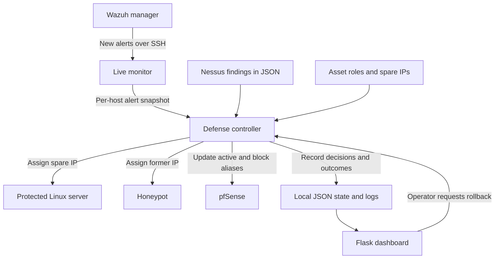

# MORPHYNX

**Adaptive Moving Target Defense for Web and Database Servers**

MORPHYNX is a cybersecurity capstone that explores how a defender can change what an intruder reaches at a familiar IP address. After repeated qualifying alerts against a protected host, the controller assigns the host a spare address and gives its former address to a honeypot. The application and its data stay on the original machine. New connections to the former address can reach the decoy while the operator investigates.

## System architecture

Wazuh supplies evidence of current activity. A Python monitor follows the manager's alert stream over SSH and counts matching events for each protected host. Nessus supplies vulnerability findings from a saved JSON report. The asset inventory connects these inputs to the host's role, network interface and pool of spare addresses.



## An incident from detection to recovery

Consider the sample web server at `192.0.2.10`. The following walkthrough illustrates the controller's decisions. The spare address is selected at runtime.

1. **Detect repeated activity.** Wazuh reports failed sign-ins against the web server. The monitor checks each alert against the host's role and increments its counter. Alerts for the database server count separately.
2. **Decide whether to act.** After three matching alerts for one host, the monitor passes a snapshot to the controller. The controller checks the target, role-specific terms, Wazuh rule level and last processed alert ID. It requires three qualifying alerts at level 3 or above before attempting a move.
3. **Move the address and place the decoy.** Suppose the controller selects `192.0.2.78`. It concurrently asks the web server to take that address and the honeypot to take `192.0.2.10`. The honeypot serves whatever decoy services the lab operator has configured.
4. **Verify the move.** The controller checks the server's active address. A match lets it record the new mapping, request a pfSense active-alias update and log `DEFENSE_TRIGGERED`. If verification fails, it reports the mismatch and skips source blocking.
5. **Contain identifiable sources.** The controller extracts source IPs from the qualifying alerts and attempts to block them using host iptables rules and a role-specific pfSense alias. The decoy address is intended to stay reachable. When logs lack a source IP, relocation can still succeed.
6. **Restore the original address.** On rollback, the controller asks the honeypot to release the old address and the server to reclaim it. It checks the server interface, clears shift state and updates the firewall alias. Source blocks can be removed separately.

## How the risk score works

The dashboard shows the highest CVSS base score found for a host alongside the project's contextual risk score (CBRS). Each input is normalized to a fraction of its maximum. The controller sums the weighted fractions and multiplies by ten.

| Input | Weight | Value for the sample web server |
| --- | ---: | ---: |
| Highest CVSS base score | 20% | 6.5/10 |
| Asset criticality | 25% | 5/5 |
| Network exposure | 20% | 5/5 |
| Known exploit available in any host finding | 15% | 0 |
| Lateral movement potential | 10% | 4/5 |
| Privilege level (`mac_privilege`) | 10% | 3/5 |

These values give the sample web server a **CBRS of 7.20/10**. Operators can use the score to interpret the impact of an incident. The implemented relocation decision uses the qualifying alert count. The inventory's `risk_threshold` field does not gate that decision.

## Reading the results

| Operator question | Evidence to inspect |
| --- | --- |
| Why did the controller act? | Monitor output shows the per-host counter. Each `RISK_ANALYSIS` entry records the score and qualifying alert count. |
| Where is the protected server now? | The asset view and `DEFENSE_TRIGGERED` entry identify the verified spare address. Test the application separately to establish service availability. |
| Which layer blocked a source? | Inspect the individual iptables and pfSense results. The aggregate status can show a block when just one layer succeeded. |
| Did rollback restore service? | Check the interface verification message and connect to the service at its original address. A `ROLLBACK` entry and alias update can occur even when address verification fails. |

Role-specific keywords and rule groups can also match legitimate failed sign-ins. Client access after an address change depends on lab routing and on firewall rules that reference the active alias.

## Run the local preview

Use Python 3.10 or later. From the repository root, create a virtual environment and install Flask.

```sh
python -m venv .venv
```

Activate it with `.venv\Scripts\Activate.ps1` in PowerShell or `source .venv/bin/activate` on Linux or macOS.

```sh
python -m pip install -r requirements.txt
python dashboard.py
```

Open **http://127.0.0.1:5050**. Leave the two demo login fields empty and submit. Compare the web and database servers in the asset view, then open the analytics view or export the inventory as CSV. The example addresses and scan scores are synthetic. Incident history starts empty.

## Repository guide

| File | Responsibility |
| --- | --- |
| `dashboard.py` | Flask interface, analytics, incident history and CSV/JSON exports |
| `morphynx_monitor.py` | Watches the Wazuh alert stream and dispatches defense processing |
| `morphynx_core.py` | Computes risk, tracks address changes, coordinates containment and rollback |
| `sync_wazuh_alerts.py` | Fetches and normalizes a snapshot of Wazuh alerts |
| `scripts/` | Shell helpers for Linux interface changes, honeypot addressing and filtering |
| `assets_config.json` | Example protected assets, alternate addresses and honeypot configuration |
| `nessus_report.json` | Example vulnerability findings keyed by host address |

## Live lab requirements

The preview runs on loopback with Flask debugging disabled. Commands submitted through dashboard POST routes require explicit opt-in through the environment variable `MORPHYNX_LIVE=1`. Direct execution of the monitor and controller can act on lab hosts independently of this switch.

A live exercise requires a configured Wazuh manager, Linux hosts, an SSH-accessible honeypot and a pfSense firewall. Review the host addresses, interface names, SSH users and firewall aliases in the Python modules, asset inventory and shell scripts before running a live exercise. Run the controller from the repository root so it can resolve its state files. The dashboard login is a presentation screen. Keep the interface local, since its API has no server-side user authentication.
